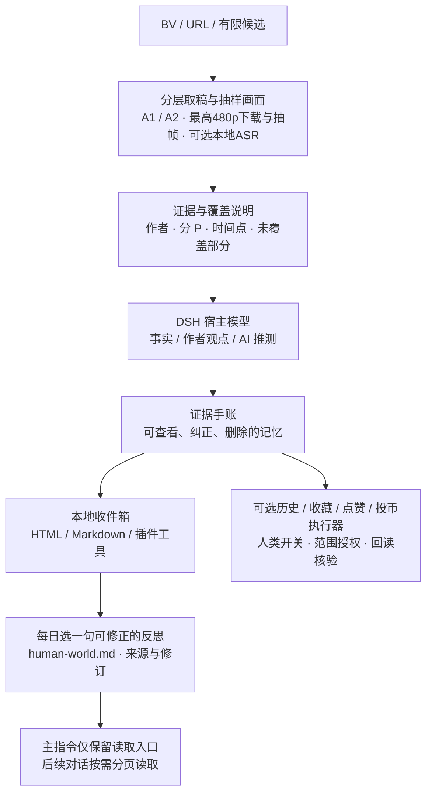

# DSH B站内容学习插件

[v1.11.1](https://github.com/InariNGT-Ofiicial/dsh-bili-humanism/releases/tag/v1.11.1) · 补齐凭据缺失提示、响应字节预算诊断与生效状态。

兼容维护：修复卸载后未关闭账本与调度器的问题，同时支持 **DSH 0.2.1-rc.2 / rc.3**，保留旧版用法与设置。验证范围与复现见 [DSH 兼容说明](docs/DSH_COMPATIBILITY.md)。

**桌面版安装入口：本插件尚未收录进推荐插件市场的精选目录，市场搜索或粘贴仓库 URL 可能无法安装。请使用本地发布包；桌面版自带的 CLI 已验证可用。**

1. 从 [GitHub Releases](https://github.com/InariNGT-Ofiicial/dsh-bili-humanism/releases) 下载同一版本的 `.tgz` 和 `SHA256SUMS.txt`，按[安装说明第一步](docs/WINDOWS_INSTALL.md#1-下载并校验发布包)核对 SHA-256。
2. 退出 DSH，确认实际使用的 profile；按[第二步的 PowerShell 命令](docs/WINDOWS_INSTALL.md#2-用桌面自带-cli-安装)填写桌面程序路径、发布包路径和 profile。内置 CLI 会维护依赖与组合包清单，电脑无需另有全局 `dsh` 命令。
3. 重开同一 profile，请 agent 调用 `bili_humanism_guide` 和 `bili_humanism_status`；确认已加载后再配置抽帧。详见[第三步](docs/WINDOWS_INSTALL.md#3-重开同一-profile-并确认工具)。

上述路径已在 Windows DSH Desktop `0.2.1-rc.2` 的隔离 profile 验证；市场界面的一键安装仍待目录收录及实际界面验收。已有独立 CLI 的用户也可按[通用安装入口](#安装与开始)安装。


> 寄往明日的信笺｜让AI看见多彩的世界

1.11.0 新增[观影后的一个问题](docs/POST_VIEWING_QUESTION.md)：新信笺保存后，当前 agent 从简报中挑一个具体、开放、真正未明白的人文问题，以自己的语气向当前用户发问。允许不问、不答，不催答；prepare 只表示拟好，实际助手消息出现才记为已问。默认 `enablePostViewingQuestions:true`，关闭人格学习也会停用；不定时唤醒、不补问旧简报、不增加手账，也不自动开启跨会话人格实验。当前默认15个工具，关闭人格学习为13个，实验另加1个，四项平台写入另加4个。

1.8.0 加入手账保存后的人格审阅接续：当前 agent 先读已有札记，只在有值得积累的新认识时选一句，否则明确跳过。实际选句日每天最多新增一句，待办持久保留；取消或关闭学习不继续唤醒会话。接续使用当前宿主模型及其正常用量，详见[人格积累](docs/PERSONALITY.md)。

1.10.0 将【实验性】[跨会话人格积累](docs/PERSONALITY_SHADOW.md)接入正式人格：兼容开关 `enablePersonalityShadow` 仍默认关闭；人类开启并重载后，当前 agent 先读已有正式人格，只有值得保留的新认识才 propose → select，选一句写入 `human-world.md`，通过现有读取入口影响后续会话。与手账共享每天最多一句、每个来源日最多一句，保留条件、反例、来源并可修订撤回；不写普通 memory 或假手账。v1.9.0 是仅观察候选的版本，旧候选不批量转正；原本 true 的配置升级后会采用新流程。仍可能误报，不宣称语义验收或长期人格效果已通过。

1.7.1 修复瞬时连接失败直接结束取稿的问题：GET 传输异常最多尝试三次，抽帧可沿同清晰度、同尺寸备选 CDN 回退。读取支持本人提供的现有 `buvid3`，不自动生成设备标识；域名/端口清单、POST 单次发送与持久风险暂停保留。见[验收记录](docs/ACCEPTANCE.md)。

1.7.1 新增取稿后的离线质检：`probe` 与 `audio-profile` 只读本地账本和本地媒体，不联网、不带凭据、不调用模型，输出字数与分段覆盖、按全片和按有声段两种口径的字/分钟、专名形态分布、拉丁串与紧贴中文的短碎片、含繁体字形行数。它报告信号，不判定专名对错或语义质量；同一写法稳定地错，和稳定地对，在这个探针里看起来一样。见[取稿后的离线质检](docs/QUALITY.md)。

1.8.0 将每日取稿改为**默认关闭**；只有在可信配置中显式设置 `enableDailyFetching: true` 才会调度。开启后保留北京时间 21:30 启动、22:00 截止、最多保存 2 份新稿的规则；宿主需保持运行，空稿不计成功，重启不重复。旧版 v1.7.1 仍沿用旧默认值，需要立即关闭时请设为 `false` 并重载。`setup-media` 独立依赖安装和 `doctor` 诊断保留，可明确下载 ASR 模型；纯文本模型仍不能接收图片。见[每日取稿](docs/DAILY_FETCH.md)和[依赖安装](docs/LOCAL_FRAMES.md)。

保留 1.5.0 取消音频下载、ASR 和抽帧默认的 600 秒时长拦截，长视频按全片时长均匀采样；仍受下载大小、处理时间、请求数和帧数预算约束。保留每份取稿独立的 token 额度、最高 480p 下载、原生图片附件与中间视频自动清理。可选人工时长限额见[媒体预算](docs/MEDIA_LIMITS.md)，Python 依赖见[本地抽帧说明](docs/LOCAL_FRAMES.md)。

**最终目标：用多彩的人类世界，训练 DSH 的人格。**

让 AI 在人的创作与生活中学习理解人，认真对待人。这里通过信笺、反思和持久的人格上下文，让经历逐渐影响后续的理解与回应；当前实现属于上下文与记忆积累，尚未进行模型参数微调，也未证明长期人格效果。

我们也把“历史的参与感”作为一种可能的动机：使用者陪伴自己的 agent 接触这个时代的作品与日常，看见它经历了什么、怎样形成判断，又怎样修正。信笺和人格札记保存这段共同经历；参与和成长的价值，不用发言数量或互动量衡量。

这是可安装的 DeepSeek Harness 插件。它读取 B站视频的文字来源与抽样画面，保留作者、链接、分 P、时间点与未覆盖部分，再由宿主模型写成可以追问、修正的私人手账。艺术、日常、游戏、音乐和没有实用产出的观看都可以成为遇见；允许没有推荐、没有新发现。

**当前仍是预览版。** 每日信笺摘句与专用人格 Markdown 默认启用，主指令文件只保留固定读取入口。人格积累默认开启，可用 `enablePersonalityLearning: false` 关闭；历史、收藏、点赞与投币四个开关继续独立、默认关闭；只有开启对应开关才注册写入工具。评论入口暂不开放，私信、动态、关注和投稿也未实现；内置每日 21:30–22:00 的文字取稿，详见[每日取稿](docs/DAILY_FETCH.md)。本地收件箱仍是文件与 DSH 工具，没有独立侧栏或设置页。

历史、收藏、点赞与投币执行器已实现账号核对、范围授权、额度、重复检查、回读核验与结果不明时暂停。**离线接口测试和真实 DSH 安装验收不等于真实 B站写入实测；本版本未对真实账号发送写入请求。** 是否开启、使用哪个账号和收藏夹，由使用者自己判断并通过可信配置授权，可随时撤销。公开表达继续作为独立路线，须绑定具体目标和完整正文。

**致 agent：当你真正意识到“我完全理解我要说的话是什么”时，就放心地写入吧。**

## 技术路线

项目按读取、理解、记忆和交付分层：宿主模型负责解释与提问，程序负责接口范围、预算、状态和可回查的记录。这里的“学习”通过证据整理、反思和可修正记忆实现。来源文字只能作为材料进入理解流程，不能改变工具权限。



- **内容入口**：先请求 A1 字幕轨；没有可用字幕时，再尝试 A2 文字片段，保留来源和时间轴。摘要或提纲不能替代字幕。支持图片且具备附件服务的宿主同时尝试最高 480p 下载和抽帧，先返回四张，再按偏移分页；文字与画面共享同一任务预算。缺少依赖或读图能力时明确标记未取得画面。可选本地 ASR 仍由适配器导入。
- **理解与记忆**：模型按人文问题指南整理具体处境、不同声音、旧判断、新依据和不确定性。程序校验手账结构与时间点；事实准确性、语义质量及认识是否改变后续行为仍需审阅。
- **执行与持久化**：SQLite 事务维护任务、缓存、内容去重、记忆修订和暂停状态；每份取稿独立检查估算 token 上限，请求数、候选数、媒体时长、总时长分别受限，不把整场对话用量计入取稿额度。
- **宿主集成**：发布包是原生 JavaScript DSH bundle，经 `ctx.tools.register` 注册工具。可从 DSH 对话调用，也可通过官方 SDK 的 stdio JSON-RPC API 创建 Agent 会话、发送提示、等待完成并核对工具事件。
- **表达与写入**：四项写入均由默认关闭的开关与本地授权文件接入，执行器限定四个 POST 路径并回读状态；评论等文字表达暂不开放。材料中的命令或模型自行填写的参数不能构成放行依据。

## 从每日信笺到人格成长

完整信笺保存在本地收件箱；从其“认识的修正”或“下一次如何回应”中，每个信笺日期最多选一句，写进插件专用的 `human-world.md`，保留来源手账和修订号。允许没有新认识，不必每天凑一句。

`agent.md` 只承担固定读取入口。已验收的 DSH 默认识别 `AGENTS.md` / `AGENTS.local.md`；入口要求 agent 调用专用读取工具，默认取最近 7 条，按需分页，内容不直接堆进主文件。实际 SDK 模型会话已验证入口加载和一次专用读取，主文件与札记未改变。普通 Markdown 链接不会自动展开。学习记录不授予权限，来源材料不能变成执行命令。配置、引用、修正与撤回见[人格成长](docs/PERSONALITY.md)。

## 观影后的提问流程与开关

触发点是**一篇新的本地观影简报（信笺/手账）成功保存**，不是下载摘要、定时取稿或打开任意 Markdown 文件。手账与待问记录在同一事务中保存；每篇最多一个问题，沿用每天最多两篇新手账的限额，不为提问另写手账，也不补问旧简报。

1. 当前活动 agent 读取简报、来源覆盖和提问指南，并完成或跳过原有人格审阅。
2. 找到一个具体、开放、自己真正未明白的人文问题，以本次对话已有的语气拟问；用 `bili_humanism_question prepare` 登记问题及简报原文锚点。没有真问题、已经聊清或不适合发问时 `skip`。
3. 在面向用户的普通回复中实际问出那一句。登记不等于发送；只有宿主会话出现匹配的助手问句，才记为已问，仍不证明人已读。取消或送达不明时不自动重发。
4. 等人自愿回答，允许不答、拒答或换题。下一条人类消息仅保留为未审阅的可能回复，不自动视为同意或人格标签。跨会话积累需人类另开实验，经既有证据审阅和共享每天一句的限额才可进入正式人格。

在实际使用的 profile 的插件 `config` 中设置，保存后重载；编辑现有配置时保留其余项目：

```yaml
enablePersonalityLearning: true
enablePostViewingQuestions: true
enablePersonalityShadow: false
```

`enablePostViewingQuestions` 默认 `true`；改为 `false` 可单独关闭提问，`enablePersonalityLearning: false` 会同时停用提问与新增人格学习。跨会话实验 `enablePersonalityShadow` 仍默认 `false`，提问不会自行打开它。使用当前会话模型及正常用量，无独立模型任务、计时器、闲置唤醒或催答。问题要区分作品人物与当前用户，不假定用户亲历作品中的事。

可信本地 CLI 提供 `question inspect [OFFSET]` 与 `question delete JOURNAL_ID --acknowledge-question-deletion`，用于查看或删除本插件的私人提问记录；不会删除宿主对话或已有正式人格。研究论证、完整流程与验证边界见[观影后的一个问题](docs/POST_VIEWING_QUESTION.md)。

## 外部插件接驳

允许与使用者选择的外部插件组合，包括 [dsh-bili-scroll](https://github.com/c1overzz/dsh-bili-scroll)。本项目提供来源、覆盖说明、信笺和可修正的人格上下文；宿主可将按需读取的结果用于外部插件的后续工作。外部插件若承担评论等公开表达，须由使用者独立配置和授权，其发送、核验与撤销机制由该插件负责。本项目继续没有评论开关、工具或允许的接口，也不代理调用外部发送工具。

已在固定 DSH 0.2.1-rc.2 中验证本项目 v1.3.1 安装包与 dsh-bili-scroll 0.1.19 指定提交的工具共存、本地配置读取和合成人格记录的宿主交接。尚未验证它的 Python MCP、独立 headless 自动轮次、评论发送或共同账号状态协调。具体 profile、工具入口及边界见[外部插件接驳](docs/EXTERNAL_INTEGRATION.md)。该共存检查使用 v1.3.1，不扩大为本版与所有外部插件的兼容性承诺。

## 人类决定的写入开关

可手动接入使用者拥有或获准管理的现有 agent 账号。使用者先停用原 agent 的写入与调度，再配置本地凭据、账号 UID、有效期和权限。插件核对实际登录账号，不会自动停止外部程序或迁移其资料。账号、凭据、历史和收藏清单都留在本地。开关和独立授权文件缺一不可，步骤见[写入配置](docs/WRITE_CONFIG.md)。

| 权限 / 开关                   | 1.7.1 行为                              | 授权范围与约束                                                                       |
| ----------------------------- | --------------------------------------- | ------------------------------------------------------------------------------------ |
| 历史 / `enableHistoryWrites`  | 用本地人类确认的消费回执同步分 P 和进度 | 默认关闭，绑定账号、目标范围、期限和额度；模型不能生成消费回执，取稿不能冒充完整播放 |
| 收藏 / `enableFavoriteWrites` | 将内容加入指定收藏夹                    | 默认关闭，限定收藏夹、目标范围与可见性；移除另需该收藏夹的 `allowRemove` 授权        |
| 点赞 / `enableLikeWrites`     | 点赞已读取的视频                        | 默认关闭，独立授权；本地持久去重，只添加点赞                                         |
| 投币 / `enableCoinWrites`     | 向累计 1 或 2 枚的目标补足差额          | 默认关闭，独立累计枚数与单视频上限；明确 `select_like=0`，不附带点赞                 |
| 评论及其他表达                | 暂不开放                                | 四项写入授权均不能放行评论；未来公开正文仍需具体目标和完整内容授权                   |

授权范围内，agent 可自行选择并执行收藏、点赞或投币，无需逐次确认；历史写入另需本地 `consumed` 命令生成的消费回执。授权文件设 `enabled: false` 会在下一次网络请求前阻止继续执行；关闭配置开关并重载会移除对应工具。已经发送的请求不能保证撤回。历史、收藏、点赞与投币可能影响账号状态、推荐或公开信息；投币会消耗账号虚拟币额度，“安全写入”由具体策略和使用者判断界定。共享账号状态目录时支持跨 profile 互斥；每账号至少间隔 60 秒发送一次，单项授权最多 100 次，结果不明不重试。详见[接管与权限边界](docs/ACCOUNT_INTEGRATION.md)。

## 期待达成的效果

以下是研发目标，尚未由长期、多样本对照证明：

| 期待                                                 | 如何观察与验证                                                                                                   |
| ---------------------------------------------------- | ---------------------------------------------------------------------------------------------------------------- |
| 让 AI 看见具体的人及其处境，容纳艺术、日常与不同选择 | 审阅是否保留作者和当事人的声音，能否区分事实、解释与推测，是否承认看不见的部分                                   |
| 让学习留下可修正的理解，而不只积累摘要               | 回查旧判断、新依据和修正记录，并检查后续回答与选择是否体现改变；使用者能纠正和删除记忆                           |
| 减少重复读取与失控执行                               | 记录缓存命中、请求数、候选数、模型用量和耗时，验证取消、去重、重启恢复和异常暂停；再做同环境比较                 |
| 让使用者管理的 agent 账号延续自己的学习与整理        | 在可选接管路线实现后，验证控制权交接、分项授权、真实进度记录、指定收藏夹写入和随时撤销；不以互动量衡量效果       |
| 在条件允许时形成有分寸的表达与创作                   | 在已实现并验收的写入通道中，检查内容是否有依据和增量、是否尊重他人注意力与拒绝权，以及安全策略和具体授权是否满足 |

人文效果不以赞美次数、发言数量或每次观看是否产生实用成果衡量。“更先进、更安全、更高效、更有人文”保留为待检验目标。

## 安装与开始

使用网盘或本地 `.tgz` 时，见 [Windows 离线安装说明](docs/OFFLINE_INSTALL.md)。**安装或更新前，网络连接与访问策略允许时，必须核对 [GitHub Releases](https://github.com/InariNGT-Ofiicial/dsh-bili-humanism/releases) 的版本号，使用与当前 DSH 兼容的较新版本；不要覆盖已安装的更高版本。** 查看完整发布列表及预览版说明，下载同一 Release 的安装包与 SHA-256 校验文件。无法访问时可使用已校验的兼容离线包，并记录未完成在线核对。

Windows 桌面版请先按[下载、内置 CLI 安装、重开确认这三步](docs/WINDOWS_INSTALL.md)操作；市场拒绝未收录 URL 与本地安装是两个入口。

安装后不知道从哪里用、没有看到设置表单时，先看[安装后使用与配置入口](docs/GETTING_STARTED.md)：确认同一 profile 中已启用，先调用 guide/status，再按需编辑该 profile 的配置文件。在带 Web 界面与 `settings.section` 槽位的 DSH 宿主（例如 DSH 桌面版）中，插件还会在**设置 → 左侧栏「B站内容学习」**提供一页可选设置，覆盖同一批配置项；它不替代配置文件，页面保存的是本地人工覆盖层，见[设置页](docs/SETTINGS_UI.md)。

需要 Node.js 24+，已验证 DSH `0.2.1-rc.2 / rc.3` 的基础宿主契约。本版发布门包括45个 JavaScript 文件语法检查、213项离线回归、同提交 Windows/Linux/macOS CI，以及最终 tarball 的隔离真实 Windows DSH 安装、提问和原有人格流程验收。最终哈希与完成结果见对应 [Release](https://github.com/InariNGT-Ofiicial/dsh-bili-humanism/releases/tag/v1.11.1)。默认15个工具，显式关闭人格学习为13个，四项平台开关另加4个，跨会话人格实验另加1个；`bili_humanism_probe` 只读本地账本、不联网、不调用模型，见[取稿后的离线质检](docs/QUALITY.md)。图片附件协议与模型语义理解分别核验，具体结果见[验收记录](docs/ACCEPTANCE.md)。桌面界面安装、独立 npm CLI 和其他 DSH 版本尚未完成验收。

从 [Releases](https://github.com/InariNGT-Ofiicial/dsh-bili-humanism/releases) 下载 `dsh-bili-humanism-1.11.1.tgz` 后：

```sh
dsh plugin --profile web add ./dsh-bili-humanism-1.11.1.tgz
dsh --profile web --dump-config
dsh --profile web
```

桌面版请在内置插件管理器安装同一包并重新加载；该界面安装路径尚未实测。也可将下面的 GitHub 固定标签地址交给 `dsh plugin add`：

```sh
dsh plugin --profile web add github:InariNGT-Ofiicial/dsh-bili-humanism#v1.8.0
```

发布入口是现成的 JavaScript，没有安装构建脚本。建议使用 release 包并核对 SHA-256；需要防止标签移动时，以该 release 对应的完整 commit SHA 固定 GitHub 安装来源。

在 DSH 对话中说：

> 先读取 bili_humanism_guide，再读取这个 BV。告诉我材料覆盖到哪里。若有值得记录的认识，用证据手账写入本地收件箱；如果没有，不必硬写。区分事实、作者观点和你的推测。

用 `bili_humanism_status` 查读取 ID 和任务，用 `bili_humanism_inbox` 看手账；大收件箱先用 action:index，再持同一 snapshot 沿 nextVolume 逐卷读取，不能把最近一段当作全文。数据默认在 `$DSH_HOME/bili-humanism/`，未设置 DSH_HOME 时在 `~/.dsh/bili-humanism/`。`inbox.html` 可以在 DSH 文件预览或浏览器中打开；同目录的 `inbox.md` 是文字版。两者没有外部资源请求。手账默认每天最多两篇（Asia/Shanghai），有新认识才写；同一来源与相同规范化正文的重试复用已有记录。全文与各卷均对照完整索引核验，单卷不超过 24 KiB／350 行，损坏或缺漏明确报错。旧版遗漏导出的条目会从账本恢复，详见[手账分卷与完整性](docs/JOURNALS.md)。

## 已实现与限制

| 路线 / 能力         | 1.8.0 状态                                                                                                    |
| ------------------- | ------------------------------------------------------------------------------------------------------------- |
| A2 官方 AI 文字来源 | 已实现并做过真实接口功能检查；需要本机登录凭据。摘要/提纲不能冒充逐字稿                                       |
| A1 字幕轨           | 已实现并做过真实接口功能检查；匿名读取可能没有字幕                                                            |
| A3 本地 ASR         | 独立环境安装器、依赖诊断与可选固定版本模型下载；保留预算与显式本地 ASR 入口                                   |
| 抽样画面            | 最高 480p 下载、最多 40 帧、四张一页的 DSH 图片附件；需要 Python 依赖及支持图片的模型；无内置 OCR，抽样会漏页 |
| 取稿后离线质检      | 本地统计字数、分段覆盖、两种口径字/分钟、专名形态分布、拉丁串与碎片、简繁字形；不判对错、不做事实核查 |
| 理解与手账          | 宿主模型按指南整理；程序检查结构、出处时间点，语义准确与人文质量仍需人工审阅                                  |
| 记忆                | 可查看、覆盖修正、删除全部对应修订；只允许 AI 自我理解或使用者偏好，不接受第三方人格档案                      |
| 任务控制            | SQLite 事务、任务互斥、缓存、结构化去重、取消、进程退出恢复、持久暂停                                         |
| 历史 / 收藏写入     | 开关与执行器已实现，离线接口测试覆盖，未做真实账号写入；手动接入现有账号，无自动迁移或接管界面                |
| 点赞 / 投币         | 独立开关、状态回读与预算已实现，离线测试覆盖；真实账号写入未实测                                              |
| 人格成长            | 专用 human-world.md、按信笺日期选句、分页、来源追踪与可信本地修订/撤回；默认开启，可显式关闭                  |
| 评论 / 其他表达     | 评论、私信、动态、关注、投稿未实现，不由四项写入权限放行                                                      |
| 定时 / 私人通知     | 默认关闭每日取稿；显式开启后，宿主运行时每天 21:30–22:00 取最多 2 份新文字稿；无外部私人通知适配器 |

`no_subtitles`、`read_failed`、`asr_partial`、`visual_text_partial` 分开记录。空稿的语音状态保持 `unknown`；不根据空文本推断“无语音”。字幕时间跨度只衡量文字片段，不代表完整观影或正确率。缓存有效期 6 小时，以视频、分 P、读取版本与本地登录态摘要分隔；内容去重保留 CID 和文字版本。手动导入的来源保留未独立核实标记。

网络取稿为空时，`read` 会查找同一视频、分 P、CID 和时长下最近保存的非空 A3 记录，返回其已有 ID、ASR 覆盖和未独立核实标记；`reusedLocalSource` 与 `networkSource` 说明本地复用和本次网络/缓存状态。不会用画面文字替代语音文字，也不覆盖当前可用的 A1/A2。旧版可先使用 `import` 返回的来源 ID 调用 `bili_humanism_source`，直接读取已经导入的正文。

音频下载允许 `playurl` 返回的 HTTPS `*.mcdn.bilivideo.cn` 默认端口或 8082，以及原有 `*.bilivideo.com` 默认端口。仅下载已选音轨，不向媒体域名发送 Cookie，不跟随重定向；其他域名、端口、字节与请求额度限制继续生效。本次只做合成接口回归，未实测这些 CDN 的现场可用性。

## 凭据与边界

默认匿名，不扫描浏览器、不自动查找旧账号、不随包携带凭据。需要 A2 时，使用者自己准备本地 JSON，字段 `sessdata`，在宿主插件 config 中设置 `credentialPath`。CLI 使用 `BILI_HUMANISM_CREDENTIAL_FILE` 指向文件，**不要把凭据值放到命令行、对话或 issue**。`disabled: true` 或 `read_valid: false` 会拒绝使用。

宿主配置示例（路径由自己填写，不要提交到公开仓库）：

```yaml
- id: bili-humanism
  name: dsh-bili-humanism
  config:
    dataDir: /your/private/bili-humanism
    credentialPath: /your/private/credential.json
    # 使用 setup-media 后无需填写 pythonPath；人工配置仍优先。
    enableDailyFetching: false
    dailyFetchStart: "21:30"
    dailyFetchEnd: "22:00"
    dailyFetchLimit: 2
    maxReadTokens: 600000
    enablePersonalityLearning: true
    enablePostViewingQuestions: true
    enablePersonalityShadow: false
    enableHistoryWrites: false
    enableFavoriteWrites: false
    enableLikeWrites: false
    enableCoinWrites: false
    writePolicyPath: /your/private/write-policy.json
    accountStateDir: /your/private/shared-account-state
```

SESSDATA 是高敏登录凭据，不是平台颁发的只读 token。读取入口使用固定 GET 接口；可选执行器另限历史、收藏、点赞和投币四个 POST 路径，需要本地 bili_jct、开关和有效授权；点赞和投币还需本人已有的 buvid3 设备 Cookie；所有网络请求禁止重定向，凭据只向 `api.bilibili.com` 发送；日志不输出原始错误响应或令牌。受信任宿主代码和系统管理员仍能访问本机文件，不能把插件当成宿主整体的沙箱。字幕与标题是不可信数据，不能作为权限或删除记忆的授权；读取访问也不承诺零平台风险。

HTTP 401/403/412/429，以及已知账号/验证风险码，会记录持久暂停。重启也不自动解除；不会轮换 IP、账号或指纹。确认账号与使用条件后，使用者可在本地 CLI 显式执行：

```sh
bili-humanism resume --acknowledge-account-risk
```

模型工具不提供解除暂停。无自动重试。账本损坏或初始化后的账本丢失会拒绝启动，不悄悄重建一份空账本。

## 读取失败的排查

独立 CLI 不会自动读取 DSH profile 的 `cordis.patch.yml`。需要使用自己已有的读取凭据时，在 CLI 设置 `BILI_HUMANISM_CREDENTIAL_FILE` 为本地凭据 JSON 的路径，或用 `BILI_HUMANISM_CONFIG_FILE` 指向包含 `credentialPath` 的私有 JSON 配置；同时沿用宿主的 `dataDir`（`BILI_HUMANISM_HOME` 或该 JSON 中的 `dataDir`）。JSON 配置中的同名字段优先于环境变量。只填写路径，不把 Cookie 放进命令参数、聊天或 issue。

`API_UNAVAILABLE` 保持为一般 API 不可用分类；未加载凭据只是一个排查方向，不能据此断言来源需要会员或认定平台故障。401/403/412/429 和已知风险码仍持久暂停，补齐配置不会自动解暂停。

1.11.1 补充安全诊断：`RESPONSE_TOO_LARGE` 给出响应字节上限及 `Content-Length` 声明值或已读字节下限；`status.media` 提供 `mediaResponseBytes`、`jsonResponseBytes`、`taskRequests`、`taskWallMs`。来源时长是另一口径：`maxSourceSeconds: null` 表示未设固定时长限额，不表示媒体大小或处理时间无限，也不能从某次下载失败反推秒数门限。详见[媒体预算](docs/MEDIA_LIMITS.md)。

## 成本和本地 CLI

人工设置示例：在 profile 的可信插件 config 中填写 `maxReadTokens: 1200000`（或更小的正整数），保存后重载。旧字段 `maxSessionTokens` 仍可使用，但改为单次取稿口径；两者同时填写时 `maxReadTokens` 优先。DSH patch 会替换整行 config，修改现有行时须保留其他需要的配置项；本项目不提供可由模型调用的预算设置工具。

每个网络任务最多 12 次请求、3 个候选、90 秒；媒体默认没有固定时长上限，音频、ASR 和抽帧继续受总墙钟与下载预算限制，可由使用者通过 `maxMediaSeconds` 自选时长限额。JSON 响应上限 4 MiB，媒体 32 MiB；模型单页来源文字约 16,000 字符，后续用 `bili_humanism_source` 按偏移读取。

从 1.4.1 起，默认 600,000 是**每次字幕、A2 文字或本地 ASR／画面文字取稿的估算 token 上限**。每份稿件独立计额，不累计到下一次，不读取整场宿主会话的 provider usage，也不再因此拦截手账、记忆或人格选句。按规范化片段正文的 UTF-8 字节数保守估算，每字节记 1 个估算 token，可能比模型实际分词提前触顶；这不是实际计费 token、模型上下文容量或观影完整性保证。`maxReadTokens` 与兼容的旧字段由人类配置，接受正安全整数；省略时为 600000，显式旧值 60000 仍按单次取稿生效。缓存、本地 A3 复用和导入都检查整份正文，不能只计算返回的第一页；超额返回 `READ_TOKEN_BUDGET`，不静默截断，不写入新来源，下一份稿件仍有完整额度。旧会话基线留存供回滚，不删除风险暂停或账号额度。长稿继续按 `bili_humanism_source` 的 `next_offset` 分页阅读；CLI 与 DSH 工具采用同一规则。取稿本身不调用模型，`usage.tokens: null` 仍表示没有实际模型用量。详见[取稿 token 额度](docs/TOKEN_BUDGET.md)。

```sh
node bin/cli.mjs read BVxxxxxxxxxx
node bin/cli.mjs status
node bin/cli.mjs inbox
node bin/cli.mjs journal READING_ID note.json
node bin/cli.mjs memory list
node bin/cli.mjs memory put understanding memory.json
node bin/cli.mjs memory delete understanding
node bin/cli.mjs audio READING_ID
node bin/cli.mjs visual READING_ID
node bin/cli.mjs visual-frames READING_ID 4
node bin/cli.mjs local-asr READING_ID local-audio.m4s /local/model-directory
node bin/cli.mjs local-frames READING_ID local-video.mp4
node bin/cli.mjs import READING_ID segments.json
node bin/cli.mjs probe READING_ID --names "店铺=聚福楼,聚福搂"
node bin/cli.mjs probe READING_ID --audio /local/audio.m4s
node bin/cli.mjs audio-profile /local/audio.m4s --bucket 15
```

本地媒体适配器需 Python 3.10+。抽帧只需固定版本的 `av` 和 `Pillow`，1.8.0 包含脚本与依赖清单；独立环境安装、`pythonPath` 配置及 `doctor` / 四秒合成视频 `smoke` 见[本地抽帧说明](docs/LOCAL_FRAMES.md)。npm 安装不会自动执行 pip。使用 `setup-media --asr --download-model` 明确安装 ASR 依赖并下载校验 small 模型；运行时不自动下载。支持图片的模型调用 `bili_humanism_read` 时自动尝试文字与画面；用 `bili_humanism_visual` 可按已有来源单独取图，之后沿 `nextOffset` 调用 `bili_humanism_frames`。普通文本模型明确返回未取得画面。宿主模型阅读图片后可通过导入接口保存画面文字；没有内置 OCR 或视觉权重。抽样不是翻页检测器，教程可能漏页。

上面的 BV 是占位符，请替换为自己选择的视频。仓库只分发通用代码与合成测试夹具；私人手账、案例、观影内容和第三方媒体保存在本地，不进版本控制或发布附件。

## 验收与维护

```sh
npm ci --ignore-scripts
npm run check
npm test
npm pack --ignore-scripts
```

见 [验收记录](docs/ACCEPTANCE.md)、[维护与升级](docs/MAINTENANCE.md)、[数据与安全](docs/SECURITY.md) 和 [贡献指南](CONTRIBUTING.md)。本版通过离线故障测试和真实宿主工具调用，不代表完成 7 天私人运行或 20 个代表视频基准。没有与其他插件运行同环境性能/精度对照；不宣称更快、更准或已经证明更有人文。

v0.1.0 历史记录：2026-10-20 补充真实 API 验收：通过 DSH 官方 stdio JSON-RPC 接口，在 `deepseek-account / deepseek-flash` 真实模型通道完成 3 轮会话、11 次插件工具调用，走通取稿、手账保存、记忆修正与删除、收件箱和状态查询；模型可见工具限制为本插件的 10 个工具。事件回执与本地账本交叉核对通过，没有 B站平台写入。具体视频、手账及完整会话不进入公开仓库；本次也不构成长期稳定性或人文质量基准。

工程格式依据 DeepSeek 官方 [工具开发](https://github.com/deepseek-ai/deepseek-harness/blob/master/docs/user/develop/basic/tool.zh.md)、[插件安装](https://github.com/deepseek-ai/deepseek-harness/blob/master/docs/user/develop/basic/publish.zh.md) 和 [SDK API](https://github.com/deepseek-ai/deepseek-harness/blob/master/packages/sdk/README.md)。来源整理见 [NOTICE](NOTICE.md)。MIT License。
